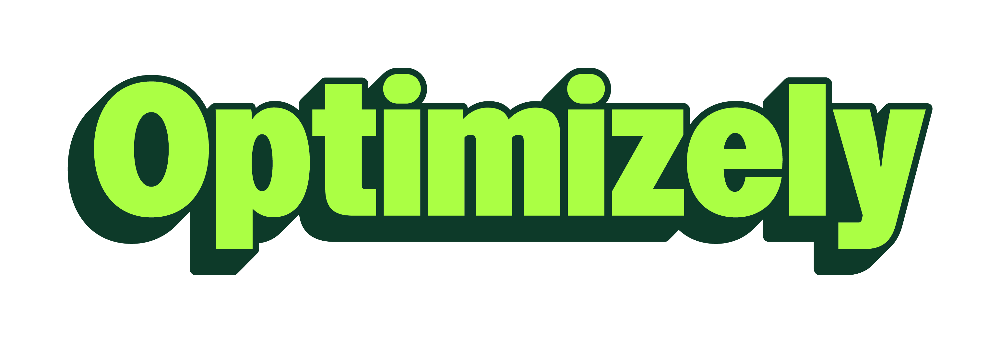

**CERTIFICATION PROGRAMME**

**Solutions Architect certification**

August 2026 · Internal — Solutions Architecture

# Purpose
This programme sets a consistent bar of excellence for how Solutions Architects position, demonstrate, and defend the value of Optimizely's AI capabilities. Each SA certifies per module by submitting a short recorded video plus a passed knowledge check. The goal isn't to memorize talking points — it's to prove an SA can walk into a customer conversation and land the what, the how, and the why it matters with confidence.

| **On naming.** Opal is Optimizely's agent orchestration platform, now presented under the Mark identity. Opal still appears inside the product and in support docs, so candidates should be comfortable with both terms and able to explain the relationship if a customer asks. |
|----|

# How certification works
Each module has five components. The first three are performed on camera; the last two support preparation and are graded.

| **\#** | **Component** | **Format** | **Recorded?** |
|----|----|----|----|
| 1 | Elevator pitch | 30 to 60 seconds, to camera | Yes |
| 2 | Live demo | 4 to 7 minutes, screen share | Yes |
| 3 | Value summary | 60 to 90 seconds, to camera | Yes |
| 4 | Knowledge check | 10 questions, written | No (submitted separately) |
| 5 | Directions and prep notes | Self-study | No |

### Suggested defaults (edit to fit your team)
- Total video length per module: 8 to 10 minutes, single unbroken recording preferred.

- Pass mark on the knowledge check: 8 out of 10.

- Assessor: a peer SA plus one SA manager, using the rubric below.

- Re-take policy: one re-record allowed within two weeks; unlimited knowledge-check re-attempts.

# Assessment rubric
The rubric applies to every module. Score each dimension from 1 to 4 (1 = not yet, 2 = developing, 3 = certified, 4 = exemplary). A module passes at an average of 3.0 or above with no dimension below 2.

| **Dimension** | **What certified (3) looks like** |
|----|----|
| Clarity of pitch | Names the capability, the problem it solves, and the outcome in under a minute, with no jargon a customer wouldn't use. |
| Demo competence | Drives the product live without fumbling, narrates what and why, and recovers gracefully from anything unexpected. |
| Business value | Ties features to measurable outcomes (pipeline, conversion, efficiency, visibility) rather than describing screens. |
| Technical accuracy | Descriptions of architecture, data flow, and governance are correct and current. |
| Objection handling | Anticipates the obvious customer pushback and addresses it in the value summary. |

# Directions for recording
Read this before every module.

> **1.** Set up a clean demo tenant. Use realistic but non-confidential sample data. Never show a live customer's data in a certification recording.
>
> **2.** Record the elevator pitch first, to camera. Imagine you've caught a prospect's attention in a hallway. No slides.
>
> **3.** Then share your screen for the demo. Follow the demo flow in the module, but make it your own. Narrate every click: say what you're doing and why it matters.
>
> **4.** Close with the value summary, back to camera. This is where you connect what they just saw to money, time, or risk.
>
> **5.** Keep it real. A small live hiccup handled well scores higher than a flawless but robotic run-through.
>
> **6.** Validate currency. These modules move fast. Before recording, skim the latest Opal release notes and the relevant support article so nothing you say is out of date.

**MODULE 1**

# Limitless 1:1 Personalization

## Directions
This module is about the difference between bucketing and genuine one-to-one relevance. Frame the demo around a target account or segment and show an experience being built for that specific buyer. Be precise about the data flow and governance — this is where technical credibility is won or lost.

## Elevator pitch
*Model pitch — adapt in your own voice.*

> *For twenty years, personalization has really meant putting people into buckets and giving everyone in the bucket the same thing. That's categorization, not personalization. Limitless 1:1 Personalization builds a genuinely tailored landing page — a microsite — for every target account or segment, researched, written, governed, and kept up to date by AI agents. It fixes the part of the funnel that always breaks: the middle, where you never have enough relevant content to go around.*

**What makes a strong pitch here:** The categorization-versus-personalization reframe, the concrete artefact (a microsite per account), and the mid-funnel problem. Land that it covers the full lifecycle — creation, governance, and ongoing optimization.

## Demo flow (4 to 7 minutes)
> **1. Frame the problem.** State the mid-funnel content gap: every member of a buying committee needs different content, and manual production can't keep up.
>
> **2. Show account intake.** Demonstrate (or describe with a sample) how the workflow pulls target accounts from the CRM.
>
> **3. Show enrichment.** Explain how each account is enriched with web research and ODP behavioural data, and how the agent infers buying-committee personas (economic buyer, technical evaluator, champion) so content addresses each role.
>
> **4. Generate a page.** Trigger the agent to produce a modular, personalized landing page for the account. Narrate that it starts from the brand's existing content foundation, so output stays on-brand.
>
> **5. Show the two modes.** Explain create (no page exists, so research plus generate plus publish) versus update (a page exists, so a lightweight check of recent CRM activity and new signals from the last three months rewrites only what changed).
>
> **6. Show publishing and governance.** CMS publishes pages to a customer subdomain, CMP approval modes handle sign-off, and marketing receives segment-specific URLs for campaigns, email, and paid media.
>
> **7. Mention delivery.** A Field Delivery Engineer assists with configuration — useful for setting expectations on implementation.

## Knowledge check (10 questions)
*The answer key is in the Annex. Remove the Annex before sending this programme to candidates.*

> **1.** What specific problem in the funnel does Limitless 1:1 Personalization target, and why does that part break?
>
> **2.** What concrete artefact does it produce for each target account or segment?
>
> **3.** List at least three data sources used to build audience intelligence.
>
> **4.** What are the two operating modes, and how does the update mode avoid redoing all the work?
>
> **5.** What is a buying committee, and why does the agent infer personas for it?
>
> **6.** How are pages published, and how is governance and sign-off handled?
>
> **7.** Give one B2B and one B2C use case the capability supports.
>
> **8.** Explain the difference between categorization and personalization as Optimizely frames it.
>
> **9.** What role does the Field Delivery Engineer play?
>
> **10.** Scenario: a prospect says, "We already run ABM with landing pages, but they go stale the moment we build them." How does Limitless answer that objection?

## Value summary
*Model summary — adapt in your own voice.*

> *The test of personalization was never whether you can generate content — everyone can now. The test is whether what actually gets published is personalized, on-brand, and still relevant when a real buyer lands on the page. Limitless owns that whole lifecycle: it creates the experience, keeps it governed, and keeps it fresh as the account changes. For an ABM team, that's the difference between 100 microsites you can't maintain and 100 microsites that maintain themselves.*

**Objection to pre-empt:** "How do we keep quality and brand control at that volume?" Generation starts from the existing content foundation, and CMP approval modes keep humans in the governance loop.

**MODULE 2**

# Conductor AEO Intelligence

## Directions
This module covers the newest ground for most customers, so definitions matter. Make sure you can explain AEO and GEO cleanly before you demo anything. Position the Conductor partnership as intelligence in, action out: Conductor supplies the visibility data, Opal turns it into published content.

## Elevator pitch
*Model pitch — adapt in your own voice.*

> *Your buyers increasingly get their answers from AI — ChatGPT, Gemini, AI Overviews — not from ten blue links. If your brand isn't showing up inside those answers, you're invisible where the decision is being made. Through our partnership with Conductor, Opal tracks your brand's share of voice across AI answer engines, pinpoints exactly where you're missing, and then drafts the content to close the gap. Conductor brings the intelligence. Opal turns it into action.*

**What makes a strong pitch here:** It names the behavioural shift (zero-click and answer engines), defines the stakes (invisible where decisions happen), and makes the Conductor-to-Opal division of labour crisp.

## Demo flow (4 to 7 minutes)
> **1. Set the context.** Briefly explain AEO and GEO — optimizing to appear in AI-generated answers, not just ranking on a results page — and why it's rising (zero-click search and LLM answer engines cutting site traffic).
>
> **2. Open Agent Visibility Analytics and the Conductor integration.** Show the brand's AI share of voice — how often and how prominently it appears in AI answers for target topics.
>
> **3. Find the gaps.** Show where competitors appear and the brand does not: the specific topics and questions where visibility is missing.
>
> **4. Draft what's missing.** Hand the gap to Opal and generate the content designed to close it. This is the intelligence-to-action moment.
>
> **5. Route to publishing.** Show the path into the CMS (for example, create pages, update metadata, apply on-page optimization) so the loop from insight to live content is complete.
>
> **6. Reinforce the loop.** Track, find gaps, draft, publish, re-measure. Frame it as a continuous visibility programme, not a one-off.

## Knowledge check (10 questions)
*The answer key is in the Annex. Remove the Annex before sending this programme to candidates.*

> **1.** What does AEO (Answer Engine Optimization) mean, and how does it differ from traditional SEO?
>
> **2.** Why is AEO becoming urgent for marketers now? Give one driver.
>
> **3.** What is the nature of the Optimizely and Conductor relationship?
>
> **4.** In one line, describe the division of labour between Conductor and Opal.
>
> **5.** What does AI share of voice measure?
>
> **6.** Describe the end-to-end AEO workflow in four steps.
>
> **7.** What surfaces the visibility data to the user inside the platform?
>
> **8.** After a content gap is identified, what does Opal do with it, and where does the output go?
>
> **9.** Why is this a continuous programme rather than a one-time project?
>
> **10.** Scenario: a customer says, "We rank number one on Google for our category — why do we need this?" How do you respond?

## Value summary
*Model summary — adapt in your own voice.*

> *Search is splitting in two. There's the results page you've optimized for years, and there's the AI answer that more and more buyers now read instead. You can be number one on the first and completely absent from the second. This gives you a live read on your visibility inside AI answers, tells you exactly where the gaps are, and closes them with published content — a continuous loop, not a report that sits in a drawer. It's how you stay visible where the decision is actually being made.*

**Objection to pre-empt:** "Isn't this just SEO with a new name?" Traditional SEO targets the results page. AEO targets inclusion in the AI-generated answer itself, which is a different surface with different mechanics.

**MODULE 3**

# Brand Packs

## Directions
This module is about turning a static brand guidelines PDF into something Opal agents apply automatically. Frame the demo around one real pack — use the Optimizely Brand pack as your reference — and land a single clean before-and-after: brand compliance as a manual review step on every asset, versus brand compliance built into the moment of generation. Be precise about the draft-and-publish lifecycle and the skill toggle, because that's where a brand team decides whether to trust it.

## Elevator pitch
*Model pitch — adapt in your own voice.*

> *Every team using AI to make content hits the same wall. Someone has to check every output against the brand guidelines before it can ship — the colors, the fonts, the tone of voice, the logo spacing, all reviewed by hand, on every asset. A Brand Pack fixes that at the source. It takes your whole brand identity — the narrative, the colors, the type, the logo rules, the asset library — and turns it from a PDF nobody reads into a machine-readable skill your agents pull from as they generate. So output is on-brand by default. Your brand team still owns the rules through a draft-and-publish workflow, but they approve once, at the pack level, instead of policing every single asset. It's brand control that scales as fast as your content does.*

**What makes a strong pitch here:** It names the pain (manual compliance review on every asset), makes the shift concrete (a PDF becomes a machine-readable skill agents use at generation), and keeps the control story intact (approve once at the pack level). Avoid describing it as just a place to store assets.

## Demo flow (4 to 7 minutes)
> **1. Open a Brand Pack.** Use the Optimizely Brand pack. Show that one pack holds the whole identity: a brand narrative, defined colors, typefaces, and an asset library. In this example that's 24 colors, seven typefaces, and many assets (logos, illustrations, icons, backgrounds, templates).
>
> **2. Walk the guidance modules.** Show the structure: Brand Strategy, Verbal Identity, Logo, Colour Usage, Type System, Art Direction, Illustration, UI and Data Visualization, AI persona treatment, and Motion. Open one — Logo is a good choice — to show it breaks into specific rules like construction, sizing, placement, clear space, and minimum sizes. Make the point: this is the guidelines document, translated into rules an agent can follow.
>
> **3. Show the lifecycle.** Point out the draft versus published states and version tracking, and explain that a brand team can update guidance without disrupting what's already live in production.
>
> **4. Show the Skill active toggle.** Explain that turning it on makes the pack a live skill any Opal agent can pull from at generation time. This is the switch that connects the guidelines to the work.
>
> **5. Show an agent scoped to the pack.** Open an agent — for example a Content Generator — that is configured to use the pack, so its output applies the guidance and assets automatically.
>
> **6. Run a plain-text prompt (the money moment).** Give the agent a simple prompt and show the output automatically respecting the logo clear-space rules, the color palette, and the brand voice — with zero manual guideline lookup. This is the single strongest thing to show.
>
> **7. Mention multi-brand.** Note that an organization can maintain multiple Brand Packs — separate packs per brand or sub-brand — and scope different agents to different brands.

## Knowledge check (10 questions)
*The answer key is in the Annex. Remove the Annex before sending this programme to candidates.*

> **1.** In one sentence, what is a Brand Pack?
>
> **2.** What does a Brand Pack contain?
>
> **3.** A Brand Pack is organized into guidance modules. Name four of them.
>
> **4.** Give three specific rules the Logo module might cover.
>
> **5.** What are the two lifecycle states of a Brand Pack, and why does that separation matter?
>
> **6.** What does the Skill active toggle do?
>
> **7.** How is a Brand Pack different from a traditional brand guidelines PDF?
>
> **8.** Where does brand approval happen in this model, and why is that the key efficiency gain?
>
> **9.** Why would an organization maintain more than one Brand Pack?
>
> **10.** Scenario: a prospect says, "We already generate content with AI, but our brand team spends hours checking every asset for compliance." How does a Brand Pack change that, and what's the single strongest thing to show them?

## Value summary
*Model summary — adapt in your own voice.*

> *Everyone's racing to generate more content with AI. The thing that actually slows them down isn't generation — it's compliance. Every asset waits on someone to check the colours, the fonts, the tone, the logo spacing. A Brand Pack builds those rules into the moment of creation, so on-brand stops being a review step and becomes the default. Your brand team doesn't lose control — they gain it, because they set the rules once and every agent inherits them. That's how you let marketing move at AI speed without the brand drifting.*

**Objection to pre-empt:** "Won't we lose brand control if agents just generate freely?" It's the opposite. Control moves upstream into the draft-and-publish workflow, so the brand team approves the rules once and every output has to follow them, instead of hoping each asset gets caught in review.

**MODULE 4**

# Virtual Teammates

## Directions
Your job in this module is to make an audience feel the shift from AI that answers when asked to AI that does the work on its own. Choose one pre-built Virtual Teammate and run it end to end. If you want to show range, reference a second teammate but only demo one properly.

## Elevator pitch
*Model pitch — adapt in your own voice.*

> *Every marketing team has work that never gets done because there's never enough people. Virtual Teammates are pre-built AI colleagues — a Chief of Staff, a Content Marketer, an SEO specialist, a Conversion Optimizer — that you hire in a click. They don't wait to be prompted. They work on schedules and triggers around the clock, they build up shared context about your brand as they go, and they get better every day. It's the headcount you wish you had budget for, without the headcount.*

**What makes a strong pitch here:** It leads with the pain (work that never gets done), gives a concrete roster, and lands the proactive, always-on, context-building difference. Avoid the word chatbot.

## Demo flow (4 to 7 minutes)
> **1. Open the Agent Platform and the agent library.** Show the roster of pre-built teammates so the breadth is visible.
>
> **2. Select one teammate** (for example the Content Marketer or SEO/GEO Specialist) and open its configuration.
>
> **3. Explain the anatomy of an agent as you go.** It combines tools (the actions it can take) with skills (the guidelines that shape how it behaves). A specialized agent packages this into one capability; a workflow agent chains several together.
>
> **4. Show a trigger.** Demonstrate that the teammate can run on a schedule, an event, or a webhook — not just on a manual ask. This is the proactive proof point.
>
> **5. Run it live.** Kick off a task (for example, draft a set of social posts, or generate a competitive-insights review) and narrate the output.
>
> **6. Point to shared context and memory.** Explain that the more the teammate runs, the more brand context it accumulates, and the better the output gets.
>
> **7. Show governance briefly.** Mention roles (User, Agent Builder, Admin), Opti ID access, and that usage runs on Opal credits — customers always ask about control and cost.

## Knowledge check (10 questions)
*The answer key is in the Annex. Remove the Annex before sending this programme to candidates.*

> **1.** In one sentence, what is a Virtual Teammate?
>
> **2.** Name three pre-built Virtual Teammates from the roster.
>
> **3.** What is the single biggest behavioural difference between a Virtual Teammate and a standard prompt-response chatbot?
>
> **4.** Agents are built from two components. Name both and define each.
>
> **5.** What is the difference between a specialized agent and a workflow agent?
>
> **6.** Give three ways a teammate's work can be triggered without a human asking.
>
> **7.** Why does shared context improve output quality over time?
>
> **8.** Which three roles govern access, and which product provides authentication?
>
> **9.** What is consumed when a teammate runs, and why should an SA raise this proactively with customers?
>
> **10.** Scenario: a B2B customer says, "We publish 20 blog posts a month but our competitive research is always stale." Which teammate(s) would you point to, and why?

## Value summary
*Model summary — adapt in your own voice.*

> *The reason this matters isn't that AI writes faster. Everyone can generate content now. The difference is finished work with fewer handoffs — a teammate that plans, drafts, and refreshes on its own, so your people spend their time on judgement and strategy instead of grunt work. You scale output without scaling headcount, and because these teammates build shared context, the quality curve goes up, not down. That's the promise: your team, unblocked.*

**Objection to pre-empt:** "Will it go off-brand?" Skills, brand context, and approval controls keep output on-brand, and humans stay in the loop where it matters.

# Appendix A — Submission checklist
Complete one per module.

☐ Single recording, 8 to 10 minutes, containing pitch, then demo, then value summary

☐ Demo used non-confidential sample data

☐ Knowledge check completed and submitted

☐ Recording checked against the latest release notes for accuracy

☐ File named: SA-Cert\_\[Module\]\_\[YourName\]\_\[YYYY-MM-DD\]

# Appendix B — Recommended prep resources
- Optimizely Opal overview and the Get started support articles (Admins, Agent Builders).

- The latest Opal release notes — these change monthly, so always check before recording.

- The Limitless 1:1 Personalization support article.

- The What's new in Optimizely Opal monthly posts, for Conductor MCP and AEO updates.

- The Brand Pack documentation and the Optimizely Brand pack as a reference example.

- Optimizely Academy — Opal Essentials.

*Because these capabilities evolve quickly, treat the model pitches, demo flows, and answer key as a living baseline. Update them each quarter against current product behaviour.*

**ANNEX — ASSESSOR USE ONLY**

# Knowledge check answer keys

| **Do not distribute.** This annex contains the answer keys for all modules. Delete these pages before sending the programme to candidates. |
|----|

## Module 1 — Limitless 1:1 Personalization
> **1. What specific problem in the funnel does Limitless 1:1 Personalization target, and why does that part break?**
>
> The mid-funnel (the consideration stage). It breaks because content production can't match the resolution the funnel demands — every buyer and role needs relevant content and manual output can't scale to that volume.
>
> **2. What concrete artefact does it produce for each target account or segment?**
>
> A personalized landing page, or microsite.
>
> **3. List at least three data sources used to build audience intelligence.**
>
> Any three of: CRM history, ODP behavioural data, web research, product data, and segment feeds.
>
> **4. What are the two operating modes, and how does the update mode avoid redoing all the work?**
>
> Create (no page exists, so it checks CMS, researches, generates, and publishes) and update (a page exists, so it runs a lightweight check of recent CRM activity and new signals from roughly the last three months, rewriting only affected sections instead of repeating full research).
>
> **5. What is a buying committee, and why does the agent infer personas for it?**
>
> The group of people involved in a B2B purchase (for example the economic buyer, technical evaluator, and business champion). Each has different concerns, so tailored content per persona is needed.
>
> **6. How are pages published, and how is governance and sign-off handled?**
>
> CMS publishes pages as content items on a customer subdomain, CMP approval modes handle governance, and teams receive segment-specific URLs.
>
> **7. Give one B2B and one B2C use case the capability supports.**
>
> B2B: account-specific ABM microsites. B2C: segment-, geography-, intent-, or product-specific pages. (Any valid example of each.)
>
> **8. Explain the difference between categorization and personalization as Optimizely frames it.**
>
> Categorization puts people in buckets and serves everyone in a bucket the same experience. Personalization builds the experience around the actual priorities, context, and intent of the individual.
>
> **9. What role does the Field Delivery Engineer play?**
>
> The Field Delivery Engineer assists the customer with configuration and implementation of the solution.
>
> **10. Scenario: a prospect says, "We already run ABM with landing pages, but they go stale the moment we build them." How does Limitless answer that objection?**
>
> It covers the full lifecycle. The update mode continuously monitors CRM signals and refreshes pages automatically, so microsites don't decay after launch, and agents govern and optimize on an ongoing basis.

## Module 2 — Conductor AEO Intelligence
> **1. What does AEO (Answer Engine Optimization) mean, and how does it differ from traditional SEO?**
>
> AEO optimizes a brand's presence inside AI-generated answers. Traditional SEO optimizes ranking on a search results page. AEO targets visibility in AI and answer engines rather than blue-link position.
>
> **2. Why is AEO becoming urgent for marketers now? Give one driver.**
>
> Any valid driver: the shift to AI answer engines, zero-click searches reducing site traffic, or buyers getting answers from LLMs instead of visiting sites.
>
> **3. What is the nature of the Optimizely and Conductor relationship?**
>
> A partnership. Conductor's AEO intelligence is integrated into Opal (via the Conductor MCP) to power AEO Intelligence agents.
>
> **4. In one line, describe the division of labour between Conductor and Opal.**
>
> Conductor brings the intelligence (the visibility data). Opal turns it into action (drafting and publishing content).
>
> **5. What does AI share of voice measure?**
>
> How often and how prominently the brand appears in AI-generated answers for relevant topics and queries.
>
> **6. Describe the end-to-end AEO workflow in four steps.**
>
> Track AI share of voice, find the gaps, draft the missing content, and publish or optimize it in the CMS (then re-measure).
>
> **7. What surfaces the visibility data to the user inside the platform?**
>
> The Agent Visibility Analytics dashboard, with the Conductor integration.
>
> **8. After a content gap is identified, what does Opal do with it, and where does the output go?**
>
> Opal drafts the content to fill the gap, and the output routes into the CMS to create or update pages and apply optimization.
>
> **9. Why is this a continuous programme rather than a one-time project?**
>
> AI answers, competitor activity, and buyer questions change constantly, so visibility must be measured and closed on an ongoing basis, not once.
>
> **10. Scenario: a customer says, "We rank number one on Google for our category — why do we need this?" How do you respond?**
>
> Ranking number one on Google doesn't guarantee appearing in AI-generated answers, which is increasingly where buyers get information. You can be number one on the results page and still be invisible inside the AI answer, and AEO measures and fixes that separate surface.

## Module 3 — Brand Packs
> **1. In one sentence, what is a Brand Pack?**
>
> A structured, machine-readable asset that centralizes a company's entire brand identity so Opal agents reference and apply it automatically at generation time.
>
> **2. What does a Brand Pack contain?**
>
> A short brand narrative, defined colors, typefaces, and a library of assets (logos, illustrations, icons, backgrounds, and templates).
>
> **3. A Brand Pack is organized into guidance modules. Name four of them.**
>
> Any four of: Brand Strategy, Verbal Identity, Logo, Color Usage, Type System, Art Direction, Illustration, UI and Data Visualization, AI persona treatment, and Motion.
>
> **4. Give three specific rules the Logo module might cover.**
>
> Any three of: construction, sizing, placement, clear space, and minimum sizes.
>
> **5. What are the two lifecycle states of a Brand Pack, and why does that separation matter?**
>
> Draft and published, with version tracking. The separation lets brand teams update guidelines without disrupting what's already live in production.
>
> **6. What does the Skill active toggle do?**
>
> It makes the pack a live skill that any Opal agent can pull from at generation time.
>
> **7. How is a Brand Pack different from a traditional brand guidelines PDF?**
>
> It's the same guidance translated into a machine-readable format that agents apply automatically, rather than a static document a human has to read and check each output against.
>
> **8. Where does brand approval happen in this model, and why is that the key efficiency gain?**
>
> At the brand-pack level, through draft-and-publish — not on every individual asset. Approving once means every downstream output inherits the rules, which removes the per-asset manual review bottleneck.
>
> **9. Why would an organization maintain more than one Brand Pack?**
>
> To hold a separate pack per brand or sub-brand, so different agents can be scoped to different brands.
>
> **10. Scenario: a prospect says, "We already generate content with AI, but our brand team spends hours checking every asset for compliance." How does a Brand Pack change that, and what's the single strongest thing to show them?**
>
> Brand rules move into the generation step, so output is on-brand by default and the per-asset review bottleneck disappears while the brand team keeps control through draft-and-publish. The strongest thing to show is a plain-text prompt going into an agent, with the output automatically respecting logo clear-space, color palette, and voice — no manual guideline lookup.

## Module 4 — Virtual Teammates
> **1. In one sentence, what is a Virtual Teammate?**
>
> A pre-built AI colleague that autonomously performs a marketing role's work, running proactively rather than only on request.
>
> **2. Name three pre-built Virtual Teammates from the roster.**
>
> Any three of: Chief of Staff, Content Marketer, SEO/GEO Specialist, Conversion Optimizer (the roster continues to grow).
>
> **3. What is the single biggest behavioural difference between a Virtual Teammate and a standard prompt-response chatbot?**
>
> It works proactively — on schedules, triggers, and events, around the clock — instead of only responding when prompted.
>
> **4. Agents are built from two components. Name both and define each.**
>
> Tools are the actions an agent can take (fetch data, create a campaign, publish content). Skills are the guidelines that shape how it uses those tools and formats output.
>
> **5. What is the difference between a specialized agent and a workflow agent?**
>
> A specialized agent is a single packaged capability that completes a task on its own. A workflow agent stitches multiple agents together into a multi-step process started by a trigger.
>
> **6. Give three ways a teammate's work can be triggered without a human asking.**
>
> Schedules, events, and webhook triggers (any of these).
>
> **7. Why does shared context improve output quality over time?**
>
> The platform builds richer brand and performance context as the teammate runs. More relevant context yields more accurate, on-brand output, so results compound over time.
>
> **8. Which three roles govern access, and which product provides authentication?**
>
> Roles: User, Agent Builder, and Admin. Authentication is provided by Opti ID.
>
> **9. What is consumed when a teammate runs, and why should an SA raise this proactively with customers?**
>
> Opal credits are consumed per run. Raising cost and consumption early builds trust and helps the customer design efficient agents (credit visibility per run supports this).
>
> **10. Scenario: a B2B customer says, "We publish 20 blog posts a month but our competitive research is always stale." Which teammate(s) would you point to, and why?**
>
> The Content Marketer for volume, paired with a Competitive Insights or SEO teammate on a schedule so research refreshes automatically. The point is combining content production with an always-on research loop.
